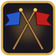

# FlagCarriers

A Warsong Gulch addon for **WoW Forever** (interface 16001).

## Features
- **Callout bar**: one-click location callouts to instance chat (FR, TUN, ROOF, RAMP, GY, MID and more), plus an "EFC LOW" button.
- **Carrier HP**: health shown next to Blizzard's flag carrier names, with drop/return timers.
- **EFC LOW banner**: a local alert when the enemy flag carrier is under 50% HP.
- **Carrier frames**: moves Blizzard's carrier frames next to the flags.
- **Enemy frames**: battleground enemy list with HP, mana, dead/alive, range, targeted-by count and a carrier highlight. Click a row to target.
- **Rez timer**: graveyard wave countdown and how many enemies are waiting to rez.
- **FC icon**: flag icon on your team's carrier in the raid frames.
- **Auto assist**: gives everyone assist when you lead a battleground raid.

## Install
Copy the `FlagCarriers` folder into `World of Warcraft/_forever_/Interface/AddOns/`.

## Commands
- `/fc unlock` / `/fc lock`: move frames by dragging; scroll over a frame to resize it.
- `/fc test`: preview everything outside a battleground.
- `/fc reset`: reset positions and sizes.
- `/fc <toggle>`: turn features on or off (`callouts`, `carriers`, `fcnames`, `blizzfc`, `lowalert`, `fcicon`, `rez`, `enemies`, `assist`).
- `/fc`: shows help and the current on/off state of every toggle.

## Credits
FlagCarriers stands on the shoulders of these, thank you:
- **vrjones1**: the [wsg rez timer and fc/efc hp](https://wago.io/cNXgQKDMd) WeakAura, which the rez timer and carrier HP are based on.
- **Bullsei**: [BattleGroundEnemies](https://github.com/BullseiWoWAddons/BattleGroundEnemies), the original enemy frames that inspired ours.
- **RBGDEV**: [BattleGroundEnemiesFixed](https://www.curseforge.com/projects/1444858), whose approach to targeting carriers and range checks on the modern client showed us the way.
- The **WeakAuras** team, for the addon the original auras were built in.
